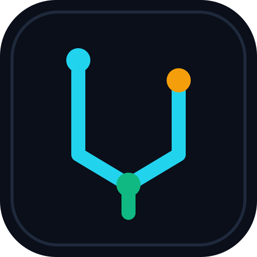
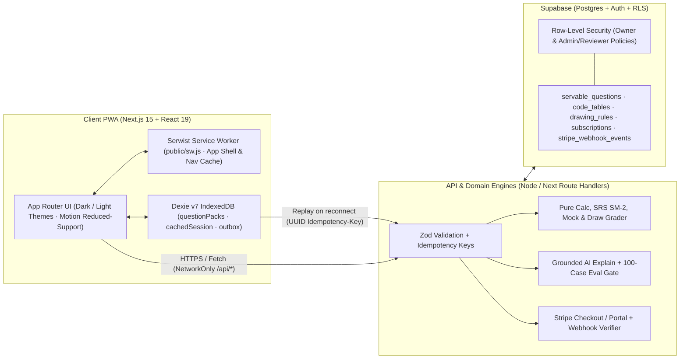

<div align="center">
  
  <h1>Bendline</h1>
  <p>
    <strong>Offline-first PWA for Journeyman Plumber licensing exam preparation</strong><br />
    Edition-aware adaptive drills, state-blueprint mock exams, deterministic plumbing calculators, and a rule-graded isometric pipe-drawing lab.
  </p>

  <p>
    <a href="https://github.com/brasseaux93-web/Bendline/actions/workflows/ci.yml">
      
    </a>
    
    
    
    
    <a href="LICENSE">
      
    </a>
  </p>
</div>

> **Disclaimer**: **Not affiliated with any code body, exam vendor, or state board.** All questions, code-navigation outlines, calculations, and isometric drawing exercises are independently authored original material. Always verify code requirements against your legally adopted edition and official licensing bulletin.

---

## Core Capabilities

Bendline is designed around real journeyman licensing constraints across **Texas (`IPC 2021` · TSBPE, closed book)**, **California (`UPC 2024` · PSI, closed book)**, and **Colorado (`IPC 2021` · PSI, open book)**, with waitlist capture for additional jurisdictions:

| Module | Route(s) | Highlights |
| --- | --- | --- |
| **Adaptive Practice & SRS** | [`/practice`](src/app/practice/page.tsx) | SM-2 scheduler (`daily_12`, `topic_drill`, `weak_spots`, `missed_review`), servable-item gate, resumable sessions, server-enforced free-tier daily cap (`12/day`). |
| **Timed State Blueprint Mocks** | [`/mock`](src/app/mock/page.tsx) | State-accurate question count, weighted topic distribution, server-authoritative countdown, navigator/flag grid, offline answer persistence, and post-submit readiness breakdown. |
| **Isometric Pipe-Drawing Lab** | [`/draw`](src/app/draw/page.tsx), [`/draw/admin`](src/app/draw/admin/page.tsx) | SVG 3-axis isometric grid (`30°`, `150°`, vertical) supporting pointer/touch, keyboard-only axes (`Arrow` / `Shift+Arrow` / `Enter`), accessible list builder, offline drafts, and deterministic `drawing_rules` grading. |
| **Deterministic Sizing Tools** | [`/tools`](src/app/tools/page.tsx) | Pure TypeScript calculators (DFU, drain sizing, vent sizing with developed length, WSFU, gas pipe sizing) backed by DB `code_tables`, plus randomized practice drills and offline step-by-step reveal. |
| **Open-Book Navigation Trainer** | [`/navigate`](src/app/navigate/page.tsx) | Enabled only when `jurisdictions.open_book = true` (e.g., Colorado; gated out for Texas/California). Tracks lookup speed (excluding backgrounded tab time), first-try accuracy, and tabbing guidance. |
| **Grounded AI Mistake Explainer** | [`/api/ai/explain`](src/app/api/ai/explain/route.ts), [`evals/`](evals/runner.ts) | Strict Zod JSON output (`{why_wrong, why_right, where_to_look, tip, followup_topic, error_type}`) using only curated seeds & paraphrased chunks, rate-limited & benchmarked by a 100-case CI eval suite. |
| **Readiness Bento & Accuracy Ledger** | [`/progress`](src/app/progress/page.tsx), [`/accuracy`](src/app/accuracy/page.tsx) | Readiness stays `null` until `15` questions are answered per topic across all 10 domains; displays mistake profile CTAs, lookup medians, drawing scores, and public licensed-review metrics. |
| **Licensed Reviewer Studio** | [`/admin/review`](src/app/admin/review/page.tsx) | Side-by-side 8-criteria review rubric with hard quality gates (`key_accuracy`, `distractors`, `edition_fit >= 4`, `calc_independently_verified`), reviewer role management, and RFC-4180 CSV export. |
| **Billing, Offline Sync & Privacy** | [`/account`](src/app/account/page.tsx), [`/legal/terms`](src/app/legal/terms/page.tsx), [`/legal/privacy`](src/app/legal/privacy/page.tsx) | Stripe Checkout & Customer Portal (`free`, `3-Month Exam Pass`, `Monthly Pro`) with env-based Price IDs, idempotent webhooks, 3-day failed-payment grace period, JSON data export, confirmed account deletion, and atomic Dexie + Serwist offline outbox replay. |

---

## System Architecture



---

## Tech Stack

| Layer | Technology |
| --- | --- |
| **Framework & Language** | Next.js 15 (App Router), React 19, TypeScript (`strict: true`) |
| **Styling & Motion** | Tailwind CSS, custom RGB design tokens (`dark` default + `light`), `motion/react`, `lucide-react` (`1.75px` stroke), Radix UI Dialog & Switch |
| **Backend & Database** | Supabase (`@supabase/ssr`, `@supabase/supabase-js`), PostgreSQL migrations with RLS (`supabase/migrations/20261120000001` through `000012`) |
| **Offline & Sync** | Serwist (`serwist`, `@serwist/next`), Dexie (`dexie` v4) transactional IndexedDB outbox |
| **Payments** | Stripe (`stripe`) Checkout Sessions, Billing Portal, HMAC webhook signature verification |
| **Validation & Forms** | Zod (`zod`), React Hook Form (`react-hook-form`), `@hookform/resolvers` |
| **Testing & Auditing** | Vitest (`vitest`, `fake-indexeddb`), Playwright (`@playwright/test`), `@axe-core/playwright`, Lighthouse (`lighthouse`) |

---

## Quick Start

### 1. Install Dependencies

```bash
git clone https://github.com/brasseaux93-web/Bendline.git
cd Bendline
npm install
```

### 2. Configure Environment (Optional for Local Preview)

Copy [`.env.example`](.env.example) to `.env.local`:

```bash
cp .env.example .env.local
```

Bendline includes a **zero-config Local Preview Mode** powered by Dexie and seeded reference data so you can run the UI, practice flows, calculators, isometric drawing lab, and test suites locally without external credentials. Populate these variables for full remote Postgres/Auth, Stripe billing, and live AI explanations:

- `NEXT_PUBLIC_SUPABASE_URL`, `NEXT_PUBLIC_SUPABASE_ANON_KEY`, `SUPABASE_SERVICE_ROLE_KEY`
- `NEXT_PUBLIC_APP_URL` (default `http://127.0.0.1:3000`)
- `STRIPE_SECRET_KEY`, `STRIPE_WEBHOOK_SECRET`, `STRIPE_PRICE_ID_PASS_3M`, `STRIPE_PRICE_ID_MONTHLY`
- `OPENAI_API_KEY` (optional; deterministic local fallback explanation structure is used when unset)

### 3. Run Locally

```bash
npm run dev
```

Open [http://localhost:3000](http://localhost:3000). Note that Serwist Service Worker caching is disabled during `next dev`; run a production build to test full offline Service Worker reloads:

```bash
npm run build
npm run start
```

---

## Verification & Quality Gates

All test, evaluation, accessibility, and build commands available in [`package.json`](package.json):

| Command | Scope |
| --- | --- |
| `npm test` | Runs Vitest across SRS, plumbing calculators (`>= 20` fixture cases per tool), mock composition, progress readiness, drawing graph invariants (50-sequence property tests), navigation drills, AI guardrails, Stripe webhook idempotency / 3-day grace, Dexie transactional outbox, and content-prompt schemas. |
| `npm run evals` | Executes the 100-case AI explanation evaluation harness (`evals/`) verifying section-pointer validity, zero verbatim code quotes, zero invented citations, and `error_type` accuracy. |
| `npm run typecheck` | Runs strict `tsc --noEmit`. |
| `npm run build` | Compiles all Next.js App Router pages/API handlers and bundles the Serwist service worker (`public/sw.js`). |
| `npm run test:e2e` | Installs/uses Playwright Chromium against a production server to verify drawing, navigation, review studio, progress/accuracy, airplane-mode offline reload + outbox replay, and `axe-core` WCAG 2.1 AA audits across all routes in both `dark` and `light` themes. |
| `node scripts/run-lighthouse.mjs` | Runs mobile Lighthouse (throttled mid-range Android emulation: `412x823`, 4x CPU slowdown) against key public and tool routes. |

---

## Repository Structure

```text
├── .github/
│   ├── ISSUE_TEMPLATE/        # Bug, content-accuracy review, and feature YAML forms
│   ├── workflows/ci.yml       # Vitest + Evals + Typecheck + Build + Playwright E2E CI
│   ├── dependabot.yml         # Weekly npm and GitHub Actions dependency updates
│   └── PULL_REQUEST_TEMPLATE.md
├── e2e/                       # Playwright E2E, offline replay, and axe-core WCAG AA specs
├── evals/                     # 100-case JSON eval harness for grounded AI explanations
├── public/icons/              # SVG app & PWA brand icons (SW outputs are gitignored)
├── scripts/                   # Mobile Lighthouse benchmarking script
├── src/
│   ├── app/                   # Next.js 15 App Router pages, API routes, manifest, sw.ts
│   ├── components/            # Domain workspaces, shared shell, auth, icons, UI primitives
│   └── lib/                   # Pure engines: srs, calc, draw, mock, ai, billing, offline, progress, review, nav
├── supabase/migrations/       # Ordered PostgreSQL + RLS schema migrations (01–12)
├── CONTRIBUTING.md
├── SECURITY.md
├── CODE_OF_CONDUCT.md
└── LICENSE
```

---

## Contributing & Governance

- Review [CONTRIBUTING.md](CONTRIBUTING.md) before opening a pull request.
- Review [SECURITY.md](SECURITY.md) for responsible vulnerability reporting and architecture security boundaries.
- Participation is governed by [CODE_OF_CONDUCT.md](CODE_OF_CONDUCT.md).
- Released under the [MIT License](LICENSE).
